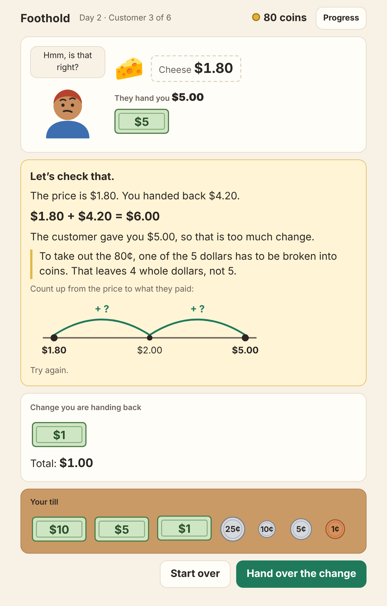
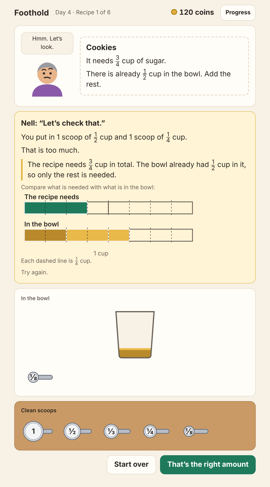
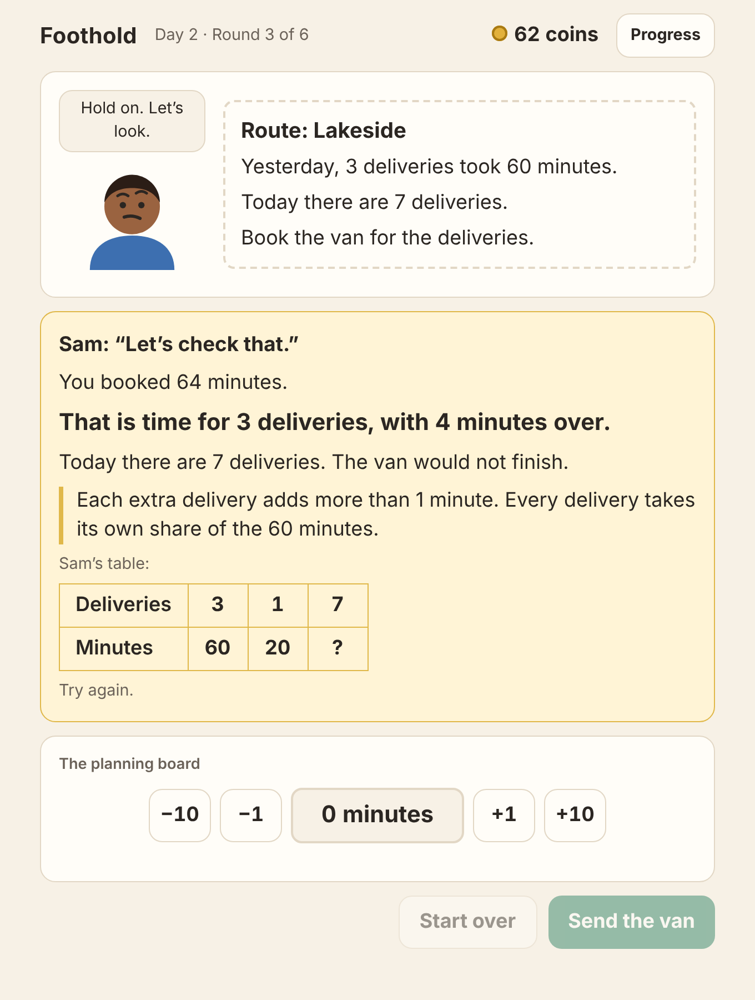
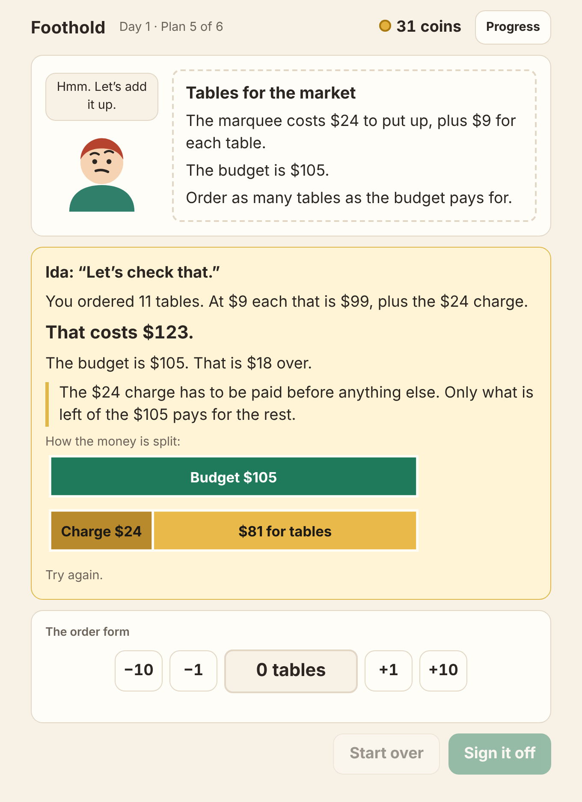
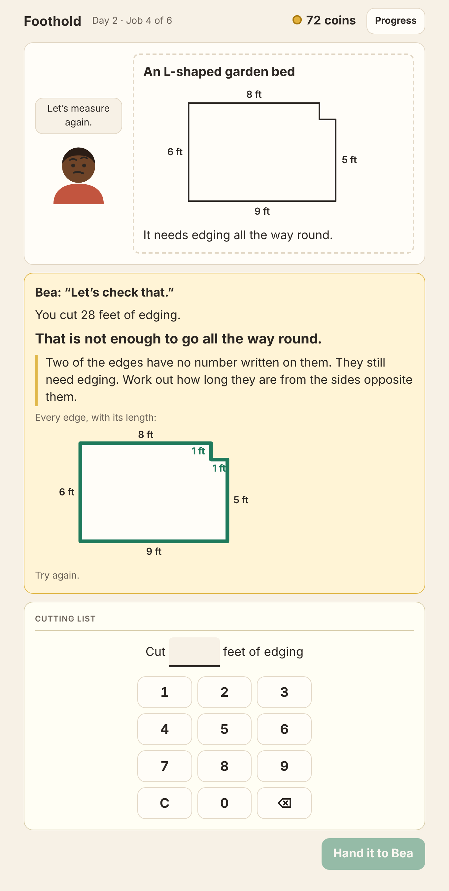

# Foothold

A free math game where the math is the job, and where a wrong answer is
treated as information about *how* the player is thinking.

Foothold is a small town whose main street has seen better days. You take
jobs there. Each job is real work that needs the math of its level, and no
job ever poses a question like "what is $5.00 − $2.40?" or "what is
3/4 − 1/2?".

Two things reward the work, and they are kept apart on purpose:

- **Coins** are wages. They buy decoration for the street and nothing else.
  No purchase makes the math easier, and no subject is locked behind saving
  up.
- **Promotions** are earned only by learning. Each business has a ladder of
  job titles, such as Trainee to Store Manager at the counter. They cannot be
  bought and are never lost. Your character's outfit follows your highest
  title, from a T-shirt to a suit and tie.

| Job | Math | What you do |
|---|---|---|
| Nell's store counter | Money, subtraction | Hand customers their change from the cash drawer, up to change from $100.00 |
| Nell's kitchen | Fractions | Measure ingredients with whichever scoops are clean |
| The delivery depot | Ratio and rate (pre-algebra) | Load boxes, book minutes, and plan how many deliveries fit |
| The town office | Linear equations (algebra) | Fill in the one number that makes a plan add up |
| The workshop | Perimeter and area (geometry) | Cut edging to go round a shape, and lay out tiles to cover it |











When an answer is wrong, Foothold does three things:

1. **Checks it in the terms of the job.** At the counter it adds the change
   back to the price. In the kitchen it draws what is needed and what is in
   the bowl as bars, to scale. At the depot it says how many deliveries
   that load or that time would cover. At the town office it adds up what
   the plan would cost.
2. **Looks for the reason.** It compares what was handed over with what a
   set of known mistake patterns would produce. Handing back $3.60 for a
   $2.40 item paid with $5.00 is the result of breaking a dollar into dimes
   and then still counting it as a dollar, and the game says so.
3. **Gives a way forward.** A picture to reason with, which gives more away
   with each further try.

It then chooses the next situations so that a suspected mistake pattern is
either confirmed or ruled out.

There are no accounts, no tracking, no ads and no server. Progress is kept
in the browser it is played in.

## Status

Early. Five jobs exist, with four to eight skills each. Money is US currency
and measures are US cups and feet. It has not yet been tried with children, so the
difficulty curve and the wording of the hints are untested guesses.

## For teachers

Foothold is a practice tool, not a tutor. It notices how an answer went
wrong and points at it, but the teaching is yours. Two ways it is meant to
be used:

- **Something to do.** "Earn 60 coins in the kitchen before the bell."
- **Something to work through.** One kind of problem, with the helping
  picture shown from the start, for a student who does better with visuals.

On Main Street, **Set a task** builds either one. Choose the job, the kind
of work (or leave it to the game), a coin goal, and whether the picture
shows before the first try. The page shows a live example of what the
student will get. You then hand out a link.

The task is written into the link itself:

```
?task=kitchen&coins=60&skill=top-up-mixed&pictures=1
```

so nothing is stored or sent anywhere, and no one needs an account. When
the goal is reached, the student gets a screen to show you: coins earned,
jobs done, how many were right the first time, and which mistake patterns
came up. Progress on a task survives a reload.

Coins fall with each retry (10, then 6, 3 and 1), so a coin goal rewards
getting it right, not clicking fast.

## Play it

Play in the browser at <https://crazy-banjo.github.io/foothold/>.

To run your own copy: Foothold is plain HTML, CSS and JavaScript with no build step and no
dependencies. Browsers will not load it straight from a file, so it needs
any static web server:

```bash
npm start
```

Then open <http://localhost:8000>. Once the game has been loaded from a web
address it keeps working without a connection.

Adding `?seed=7` to the address replays the same run of customers.

## How the diagnosis works

Each mistake pattern is a small function that answers one question: *if
someone thought this way, what would they hand over here?* Diagnosis asks
which patterns predict what was actually handed over.

At the counter ($2.40 paid with $5.00, unless noted):

| Pattern | Hands back |
|---|---|
| Breaks a dollar but still counts it | $3.60 |
| Takes the smaller digit from the larger | $3.40 |
| Regrouping across a zero | $2.73 for a $2.37 item |
| Hands back the price | $2.40 |
| Ignores the cents in the price | $3.00 |
| Leaves out the cents | $2.00 |
| Leaves out the dollars | 60¢ |

In the kitchen:

| Pattern | Example |
|---|---|
| Counts the bottom number | 4 quarter-cup scoops for 3/4 cup |
| Uses a single scoop | 1 quarter-cup scoop for 3/4 cup |
| Keeps the top number when the scoop changes | 1 eighth-cup scoop for 1/4 cup |
| Adds the same number to top and bottom | 1/2 "becomes" 3/4 |
| Ignores what is already in the bowl | adds 3/4 cup when 1/2 cup is there |
| Subtracts tops and bottoms separately | 3/4 − 1/2 = 2/2 |
| Subtracts the tops across different sizes | 3/4 − 1/2 = 2/4 |
| Leaves the amount as it is | 3/8 cup for two batches of 3/8 cup |
| Multiplies the bottom number | two batches of 1/2 cup = 1/4 cup |
| Adds instead of multiplying | two batches of 3/8 cup = 5/8 cup |
| Halves the bottom number | half of 1/4 cup = 1/2 cup |

At the depot, where deliveries, boxes and minutes are linked:

| Pattern | Example |
|---|---|
| Adds instead of multiplying | 7 deliveries of 6 boxes: 7 + 6 = 13 |
| Adds instead of scaling | 4 deliveries took 60 minutes, so 10 take 66 |
| Uses yesterday's amount | 60 minutes again, for 10 deliveries |
| Stops at how many times as many | 12 deliveries is 3 times 4, so 3 |
| Leaves out the head start | loads every box when 12 are already on the van |
| Subtracts instead of dividing | 48 boxes at 6 each: 48 − 6 = 42 deliveries |
| Counts a part delivery | 50 boxes at 6 each: 9 deliveries |
| Forgets the loading time | divides all the time by the time for a delivery |
| Stops at the number of deliveries | enters 8 deliveries as the minutes |
| Multiplies the two amounts for one delivery | 6 boxes × 15 minutes = 90 |

At the town office ($6 charge plus $2 each from a $26 budget; the answer
is 10, from 6 + 2n = 26):

| Pattern | Orders |
|---|---|
| Leaves out the charge | 13 (26 ÷ 2) |
| Stops after taking off the charge | 20 (26 − 6) |
| Divides before taking off the charge | 7 (26 ÷ 2 − 6) |
| Adds the charge to the budget | 16 ((26 + 6) ÷ 2) |
| Joins the charge and the price | 26 ÷ 8, when that is a whole number |
| Rounds up past the budget | one more than the budget pays for |
| Takes the cost off the target | when raising money: subtracts the cost instead of adding it |
| Leaves out the cost | when raising money: target ÷ price |
| Stops at the money needed | when raising money: target + cost |
| Adds the two prices each | two offers $30 apart at $3 and $1 an hour: 30 ÷ 4 |
| Uses only one of the prices each | the same two offers: 30 ÷ 3 |
| Stops at the gap between the charges | the same two offers: 30 |
| Adds the two charges | ($20 + $50) ÷ 2 |
| Treats every ticket as the higher price | $60 from $6 and $2 tickets: 60 ÷ 6 |
| Adds the two ticket prices | $88 from $5 and $3 tickets: 88 ÷ 8 |

In the workshop (a 4 by 3 rectangle, unless noted):

| Pattern | Example |
|---|---|
| Gives the space inside for the distance round | 12 feet of edging |
| Gives the distance round for the space inside | 14 tiles |
| Adds just two sides | 4 + 3 = 7 |
| Adds only the sides with a measurement | leaves out the two unmarked sides of an L shape |
| Ignores the cut-away corner | tiles an L shape as a full rectangle |
| Counts the overlap twice | splits an L shape into two overlapping rectangles |
| Forgets to halve the triangle | 6 × 4 = 24 for a triangle that is 12 |

The counter's column patterns follow the subtraction "bugs" catalogued by
Brown and Burton (1978) and VanLehn (1990). Most of the kitchen's patterns
come from treating the top and bottom of a fraction as two separate whole
numbers, often called whole-number bias. The depot's scaling pattern is
additive reasoning, the most widely reported error in ratio problems.

One wrong answer is weak evidence, and sometimes more than one pattern
explains it. So the game keeps a running level of evidence for each pattern.
A hint about a pattern is given only when one pattern explains the answer,
or when the player has shown that pattern before. Getting a situation right
where a pattern would have gone wrong counts against it.

The check and the picture are true whatever the cause, so the player is
never told something false when the diagnosis is uncertain.

A pattern can only be recognised if its wrong answer can actually be handed
over. In the kitchen, an answer such as 2/5 cup cannot be measured with the
scoops, so "adds tops and bottoms" does not appear there yet.

## Adding a job

A job is one object (see `src/engine/diagnose.js` for the full list of what
it provides): its skills in teaching order, a generator of situations, the
right answer for a situation, and its mistake patterns. Every answer is a
whole number of some small unit, such as cents or twenty-fourths of a cup.
The learner model, the diagnosis and the choice of the next situation are
shared by all jobs. A job also needs a screen in `src/game/`, which either
hands over pieces (bills, scoops) or fills in a number on a form with a
number pad.

## Layout

```
index.html, styles.css   the page
sw.js                    offline support
src/engine/              shared by every job: no browser code
  diagnose.js            matching an answer to mistake patterns
  learner.js             mastery, evidence, choosing the next situation
  rng.js                 a seeded random number generator
src/counter/             the store counter: money, situations, patterns
src/kitchen/             the kitchen: fractions, situations, patterns
src/depot/               the delivery depot: situations, patterns
src/office/              the town office: plans, situations, patterns
src/workshop/            the workshop: shapes, situations, patterns
src/game/                the screens: Main Street, each job, the story
test/                    tests for the engine and every job
```

## Tests

```bash
npm test
```

Needs Node.js 20 or later. Nothing to install.

## Where this is going

Every subject on the first list now has a job. What is missing inside them:

- **Kitchen:** adding two amounts in different sizes, which needs a way of
  answering other than scoops.
- **Town office:** the rest of a first algebra course that a job can
  carry: straight-line price lists, "at least" and "at most", and
  quadratics through area. Symbol work such as factoring is left out on
  purpose, because no job needs it.
- **Workshop:** angles, and the space inside a box.
- **The street:** each job screen drawn as the tool it uses, and repairs to
  buy for every building, not only the store.

## Contributing

The most useful contributions are observations of real learners: an answer
the game failed to explain, a hint that did not help, or a mistake pattern
that is missing. Please open an issue with the situation and what was
handed over.

## License

GPL-3.0-or-later. See [LICENSE](LICENSE).
